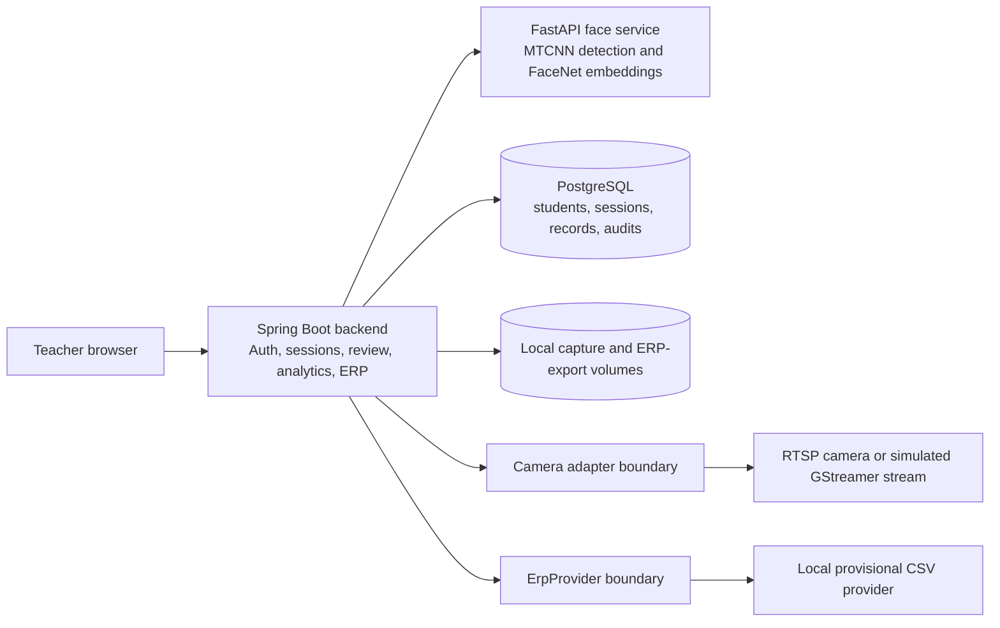

# ClassSight architecture

The Spring service owns authentication, authorization, enrollment orchestration, capture persistence, attendance records, manual review, analytics/PDF reporting, ERP synchronization, and camera health state. The FastAPI service performs MTCNN detection, FaceNet embedding, and tiered matching. PostgreSQL persists business state, MinIO stores private photos, and RabbitMQ supports asynchronous recognition work.
